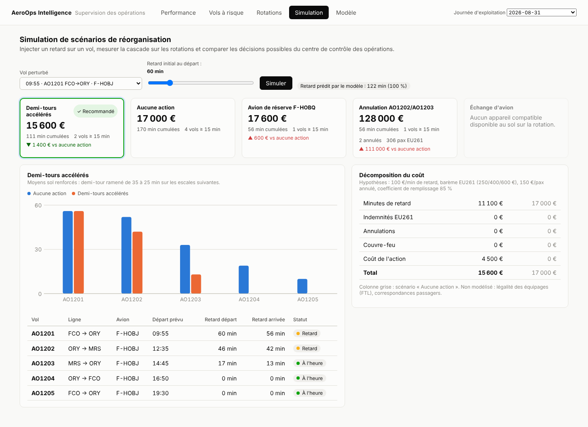
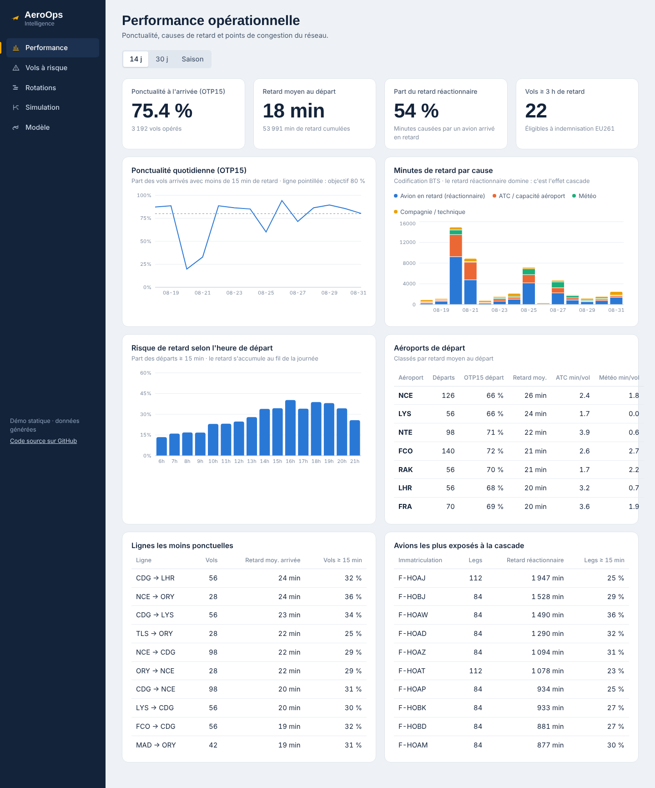
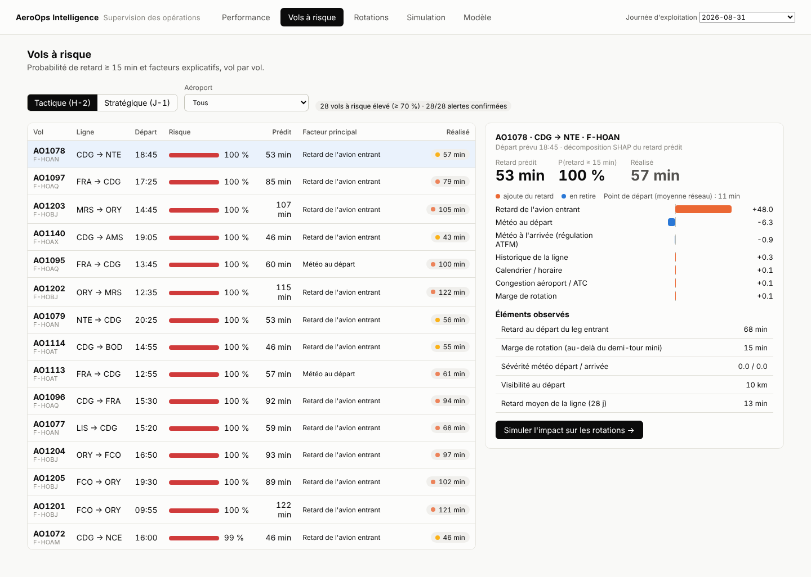
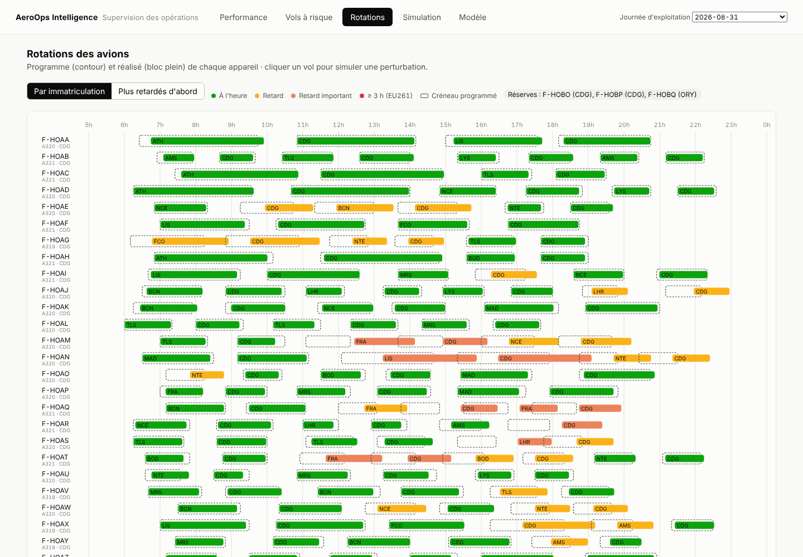
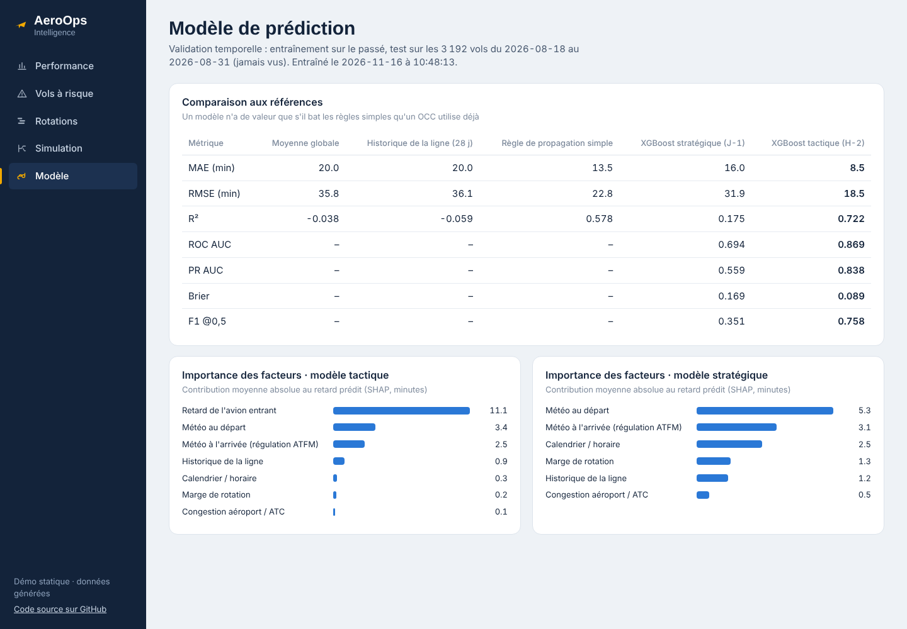

# AeroOps Intelligence

**Prédiction des retards et aide à la décision pour un centre de contrôle des opérations aériennes (OCC).**

[](https://github.com/stevvvvvv/AeroOps-Intelligence/actions/workflows/ci.yml)
**Démo en ligne : [stevvvvvv.github.io/AeroOps-Intelligence](https://stevvvvvv.github.io/AeroOps-Intelligence/)** (version statique, données de démonstration générées)

Un vol risque de partir avec 45 minutes de retard. La plateforme estime ce retard, explique d'où il vient (avion entrant en retard, orage au départ, régulation ATFM à l'arrivée…), calcule son effet sur les vols suivants du même avion, puis compare cinq décisions possibles et recommande la moins coûteuse.



## Ce que fait le projet

| Fonction | Implémentation |
|---|---|
| Données historiques de vols | Connecteur **BTS On-Time Performance** (vols réels, immatriculations, causes de retard) + générateur de démo hors-ligne au même schéma |
| Données ADS-B | Client **OpenSky Network** (OAuth2) : reconstruction des rotations réelles et temps au sol effectifs |
| Météo | **METAR** horaires (Iowa Environmental Mesonet) → indice de sévérité opérationnelle (orage, LVP, rafales, plafond) |
| Prédiction ML | **XGBoost** : régression (minutes) + classification (P(retard ≥ 15 min)), deux horizons : stratégique J-1 et tactique H-2 |
| Explicabilité | Valeurs **SHAP** natives XGBoost regroupées en 7 familles de causes lisibles par un contrôleur d'opérations |
| Retards en cascade | Propagation le long de la rotation avec marges de demi-tour et récupération en vol |
| Simulation de scénarios | 5 options chiffrées en € : aucune action, demi-tours accélérés, avion de réserve, échange d'avion (tail swap), annulation d'un aller-retour |
| Dashboard | Front **React** : performance (OTP15, causes, congestion), vols à risque, Gantt des rotations, simulateur, page modèle |
| API | **FastAPI** (doc interactive sur `/docs`) |
| Orchestration | DAG **Airflow** quotidien avec ré-entraînement hebdo et garde-fou qualité |
| Stockage | **SQL** : SQLite en local, PostgreSQL en conteneur ; KPI écrits en SQL pur (`sql/kpis.sql`) |
| Déploiement | **Docker** multi-étapes + docker-compose (API + Postgres + Airflow optionnel) |

## Résultats (jeu de démo, test sur 14 jours jamais vus)

Validation **temporelle** (train sur le passé, test sur les 3 192 derniers vols), comparée à trois références :

| | MAE (min) | R² | ROC AUC | Brier |
|---|---|---|---|---|
| Moyenne globale | 14,2 | 0,00 | – | – |
| Historique de la ligne (28 j) | 13,5 | -0,03 | – | – |
| Règle de propagation simple (OCC) | 10,3 | 0,51 | – | – |
| XGBoost stratégique (J-1) | 10,2 | 0,47 | 0,76 | 0,114 |
| **XGBoost tactique (H-2)** | **6,3** | **0,78** | **0,85** | **0,073** |

Lecture honnête :
- **Le modèle tactique réduit l'erreur de 39 % par rapport à la règle métier** qu'un OCC applique déjà (6,3 contre 10,3 min). C'est le seul chiffre qui compte : battre une moyenne n'a aucune valeur.
- **Le modèle stratégique (J-1) ne fait pas mieux que la règle simple en MAE.** C'est attendu : la veille, on ignore l'essentiel de ce qui fera le retard (incidents techniques, propagation du jour). Il sert à repérer les journées et les vols structurellement fragiles, pas à prédire à la minute près.
- La période de test inclut deux jours de grève ATC.
- Les chiffres exacts varient légèrement selon la version de NumPy (le générateur aléatoire ne produit pas exactement les mêmes données d'une version à l'autre) ; l'ordre de classement des modèles, lui, reste le même.

## Démarrage rapide

```bash
pip install -r requirements.txt      # installe aussi le projet (pip install -e .)
python -m aeroops.cli demo           # génère 4 mois de données, entraîne, score (~20 s)
uvicorn aeroops.api.main:app --reload   # http://localhost:8000/docs
```
Dans un 2e terminal :
```bash
cd frontend
npm install
npm run dev                          # http://localhost:5173
```
Tests : `python -m pytest -q`. Le projet est installé en mode éditable : aucun `PYTHONPATH` à définir, sous Windows comme sous Linux.

Tout-en-un avec Docker : `docker compose up --build` puis http://localhost:8000. Avec Airflow : `docker compose --profile airflow up` (UI sur le port 8080).

### Données réelles

```bash
python -m aeroops.cli ingest-bts --year 2024 --month 7 --carriers B6
python -m aeroops.cli features && python -m aeroops.cli train && python -m aeroops.cli score
```
JetBlue (B6) est un bon choix : hub JFK, beaucoup d'orages d'été, rotations denses. Pour OpenSky, créer un compte gratuit et renseigner `OPENSKY_CLIENT_ID` / `OPENSKY_CLIENT_SECRET` (voir `.env.example`).

## Méthode

### Pourquoi un générateur de données ?
Les sources réelles demandent un accès réseau (et un compte pour OpenSky). Le générateur (`src/aeroops/data/synthetic.py`) ne tire pas des retards au hasard : il simule les **mécanismes** qui les créent, pour que le modèle ait quelque chose de réel à apprendre.
- 40 A319/A320/A321 basés à CDG et ORY, programme saisonnier répété chaque jour, 17 aéroports européens.
- Météo horaire par aéroport : orages convectifs l'après-midi (Nice, Lyon), brouillard matinal (Bordeaux, Lyon), mistral (Marseille), fronts pluvieux.
- Retards primaires : météo au départ, régulations ATFM liées à la météo à destination, congestion par heure de pointe, incidents techniques, 3 jours de grève du contrôle aérien français.
- Propagation : un avion arrivé en retard retarde son vol suivant si la marge de demi-tour ne suffit pas.

Calibrage obtenu : ponctualité OTP15 ≈ 82 % sur la saison et **retard réactionnaire ≈ 48 % des minutes**, un ordre de grandeur proche de ce que publie Eurocontrol pour l'Europe.

### Features sans fuite de données
Chaque variable doit être connue au moment de la prédiction (`src/aeroops/features/build.py`) :
- historique calculé uniquement sur les jours **précédents** (testé dans `tests/test_pipeline.py`) ;
- modèle tactique : retard **au départ** du leg entrant (connu dès que l'avion a décollé), jamais son retard à l'arrivée ;
- limite assumée : la météo observée sert de proxy à la prévision (TAF), ce qui rend le modèle un peu optimiste sur la composante météo.

### Coûts des scénarios (`src/aeroops/config.py`)
100 €/min de retard, indemnités **EU261** (250/400/600 € par passager selon la distance au-delà de 3 h de retard ou en cas d'annulation), 150 €/passager annulé, 12 000 € pour un avion de réserve, 1 500 € par demi-tour accéléré, 2 000 € par échange d'avion, pénalité de couvre-feu à Orly (23h30). Toutes ces hypothèses sont modifiables.

### Démo en ligne (site statique)
La démo, hébergée sur GitHub Pages, est un site statique, sans serveur Python. À chaque push sur `main`, GitHub Actions entraîne le modèle, puis `scripts/export_static.py` pré-calcule en JSON toutes les réponses de l'API : KPI, prédictions, explications SHAP, rotations. La simulation de scénarios, elle, est recalculée dans le navigateur par un port JavaScript du moteur Python (`frontend/src/sim/simulation.js`). Avant chaque publication, le workflow vérifie que ce port donne exactement les mêmes résultats que Python. Seule différence avec la version complète : le dashboard propose trois périodes fixes au lieu d'un choix de dates libre.

### Limites connues
- Légalité des équipages (FTL) et correspondances passagers non modélisées : un vrai OCC vérifie les deux avant un échange d'avion.
- Les scénarios sont évalués un par un (heuristique), pas par optimisation globale du réseau (programmation linéaire en nombres entiers : piste d'amélioration naturelle).
- BTS ne fournit pas l'emport : 150 sièges supposés sur données réelles.

## Structure

```
src/aeroops/
  data/        synthetic.py · bts.py · metar.py · opensky.py
  features/    build.py               feature engineering anti-fuite
  models/      model.py               XGBoost, baselines, SHAP
  ops/         simulation.py          cascade + 5 scénarios chiffrés
  api/         main.py                FastAPI
  pipeline.py · cli.py · db.py · config.py
sql/           schema.sql · kpis.sql
airflow/dags/  aeroops_pipeline.py
frontend/      React + Vite + Recharts
scripts/       export_static.py (démo statique)
.github/       CI (tests + build) et déploiement de la démo sur GitHub Pages
tests/         propagation, anti-fuite, API de bout en bout
docs/          architecture.md (diagrammes Mermaid) · screenshots/
```

## Captures

| Performance | Vols à risque |
|---|---|
|  |  |
| **Rotations** | **Modèle** |
|  |  |

---
Steven Jansen · Projet portfolio n°3 · Mastère Big Data, Développement & IA (IPSSI)
